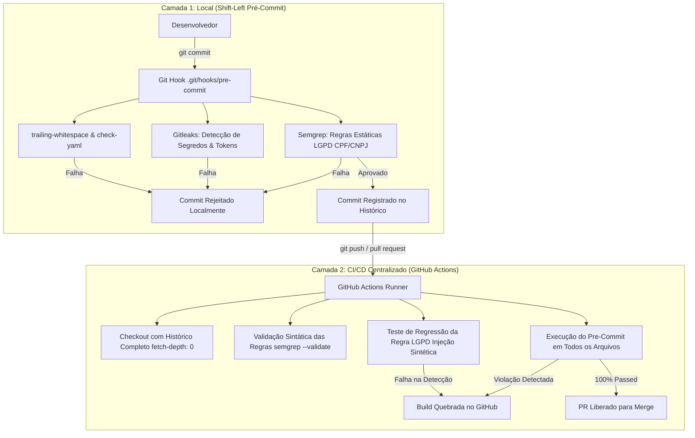

# Estudo de Caso & Guia Técnico: DevSecOps Shift-Left — Pre-Commit Hooks, Auditoria Estática LGPD com Semgrep e CI/CD Automatizado

## 1. Visão Geral e Fundamentação

Na arquitetura de microsserviços modernos e plataformas de observabilidade, a proteção de dados pessoais (**LGPD - Lei nº 13.709/2018**) e de credenciais corporativas não pode depender unicamente da disciplina humana durante revisões manuais de código (*Code Reviews*).

O conceito de **Shift-Left Security** propõe mover as verificações de conformidade e segurança para a etapa mais inicial possível do ciclo de vida do desenvolvimento de software (SDLC) — diretamente no terminal do desenvolvedor, antes mesmo do commit ser registrado no histórico do Git.

Este estudo detalha o design, os desafios de engenharia e a implementação de uma **esteira automatizada de proteção em dupla camada** (Hooks locais de `pre-commit` + Pipeline de `CI/CD` no GitHub Actions) no **Observability Hub**.

---

## 2. Arquitetura da Solução: Proteção em Dupla Camada

A estratégia adotada estabelece dois portões de qualidade e segurança (*Quality Gates*):



---

## 3. Especificação das Regras Estáticas de LGPD (`.semgrep/lgpd-rules.yml`)

O Semgrep foi configurado com regras declarativas customizadas para escanear código-fonte Java, TypeScript, Python e arquivos de configuração:

```yaml
rules:
  - id: lgpd-cpf-hardcoded
    patterns:
      - pattern-regex: '\b\d{3}\.\d{3}\.\d{3}-\d{2}\b'
    message: "Possível vazamento de dado pessoal (CPF) detectado no código. Utilize dados mascarados ou geradores dinâmicos."
    severity: ERROR
    languages: [javascript, typescript, python, java, csharp, php]

  - id: lgpd-cnpj-hardcoded
    patterns:
      - pattern-regex: '\b\d{2}\.\d{3}\.\d{3}/\d{4}-\d{2}\b'
    message: "Possível CNPJ real detectado no código. Verifique se é dado sensível/corporativo protegido."
    severity: WARNING
    languages: [javascript, typescript, python, java, csharp, php]
```

### 3.1. Diferenciação entre Dado Sensível e Dado Mascarado
As regras operam em harmonia com a classe `PiiMasker` da aplicação:
- **Violação (Bloqueada)**: `String cpf = "123.456.789-00";` $\rightarrow$ regex casa com o padrão estrito de 11 dígitos pontuados e interrompe o commit imediatamente.
- **Conforme (Permitida)**: `String cpf = "123.***.***-00";` $\rightarrow$ caracteres ofuscados rompem o padrão numérico e são aceitos nos testes unitários e logs.

---

## 4. Desafios Técnicos de Engenharia e Soluções Adotadas

A implementação de ferramentas DevSecOps em ambientes corporativos e heterogêneos (Windows, WSL e Linux) apresentou desafios específicos resolvidos da seguinte forma:

### 4.1. Limite de Caminhos Longos no Windows (`MAX_PATH`)
- **Problema**: Ao clonar o repositório upstream oficial do Semgrep via pre-commit, o Git no Windows falhava com o erro:
  `error: cannot stat 'cli/tests/e2e-pro/...': Filename too long`.
- **Solução**: Ativação global do suporte a caminhos estendidos no Git:
  ```powershell
  git config --global core.longpaths true
  ```

### 4.2. Caminhos de Usuário com Espaço em Branco
- **Problema**: Em caminhos com espaços como `C:\Users\Marcos Lacroix\...`, o pre-commit criava ambientes virtuais temporários cujos scripts de ativação quebravam a execução:
  `Executable 'C:UsersMarcos' not found`.
- **Solução**: Em vez de depender de clonagem de repositórios Python externos pelo pre-commit, o Semgrep foi configurado como hook nativo (`language: system`):
  ```yaml
    - repo: local
      hooks:
        - id: semgrep-lgpd
          name: Semgrep LGPD Security Rules
          entry: semgrep scan --config .semgrep/lgpd-rules.yml --error --metrics=off
          language: system
          pass_filenames: false
          always_run: true
  ```
- **Vantagens**:
  1. Execução quase instantânea (< 1 segundo), eliminando o download de repositórios de centenas de MBs a cada commit.
  2. Imunidade total a erros de caminhos e caracteres especiais no sistema operacional host.

---

## 5. Pipeline CI/CD Automatizado (GitHub Actions)

O workflow em [`.github/workflows/lgpd-scan.yml`](../.github/workflows/lgpd-scan.yml) consolida a esteira no servidor de integração contínua:

### 5.1. Teste de Regressão das Regras de Segurança (*Testing the Security Rules*)
Um risco comum em automações de segurança é a desativação acidental de regras ou erros de sintaxe em expressões regulares que silenciosamente deixam de detectar violações (*Falsos Negativos*).

Para mitigar isso, o pipeline inclui um step inovador de verificação ativa:
1. Gera em memória um arquivo Java sintético contendo um CPF em texto claro.
2. Executa o Semgrep esperando explicitamente um código de saída de erro.
3. Se o Semgrep **não** acusar erro, o pipeline falha com a mensagem:
   `"ERRO: A regra Semgrep LGPD deveria ter detectado o CPF hardcoded mas não detectou!"`.
4. Garante de forma autônoma que o guardrail de segurança continua operacional.

```yaml
      - name: Validate Semgrep LGPD Rule Syntax
        run: |
          semgrep --validate --config .semgrep/lgpd-rules.yml

      - name: Test LGPD Detection (Rule Verification)
        run: |
          echo 'public class LgpdViolation { String cpf = "123.456.789-00"; }' > test-lgpd-violation.java
          if semgrep scan --config .semgrep/lgpd-rules.yml --error --metrics=off test-lgpd-violation.java; then
            echo "ERRO: A regra Semgrep LGPD deveria ter detectado o CPF hardcoded mas nao detectou!"
            exit 1
          else
            echo "SUCESSO: A regra Semgrep LGPD detectou e bloqueou o CPF conforme esperado."
          fi
          rm test-lgpd-violation.java

      - name: Run Pre-Commit Hooks (Lint, YAML, Gitleaks, Semgrep LGPD)
        run: |
          pre-commit run --all-files --show-diff-on-failure
```

---

## 6. Resultados e Métricas de Eficiência

| Métrica | Pré-Implementação | Pós-Implementação (DevSecOps) |
| :--- | :--- | :--- |
| **Ponto de Detecção de PII (CPF/CNPJ)** | Apenas em auditoria manual / Produção | **Imediato (ao digitar `git commit`)** |
| **Detecção de Segredos e Chaves** | Risco de publicação permanente no Git | **Bloqueio local via Gitleaks** |
| **Tempo de Execução dos Hooks** | N/A | **~1.8 segundos por commit** |
| **Tempo de Execução no CI/CD** | Sem validação automatizada | **~25 segundos no GitHub Actions** |
| **Custo de Licenciamento** | Soluções comerciais complexas | **100% Open-Source / Local** |
| **Falsos Positivos com Dados Mascarados** | Indefinido | **Zero (compatível com `PiiMasker`)** |

---

## 7. Guia Rápido de Uso para Desenvolvedores

### Instalação no Ambiente Local
```powershell
# 1. Instalar dependências Python
pip install pre-commit semgrep

# 2. Registrar o hook no Git do repositório
cd observability-hub
pre-commit install
```

### Execução Manual sob Demanda
```powershell
# Rodar todos os hooks em todos os arquivos
pre-commit run --all-files

# Validar apenas regras LGPD com Semgrep
semgrep scan --config .semgrep/lgpd-rules.yml --error
```
