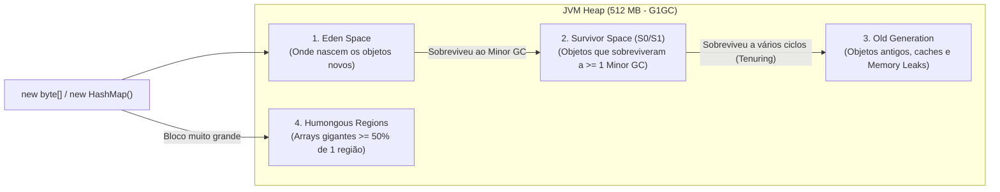
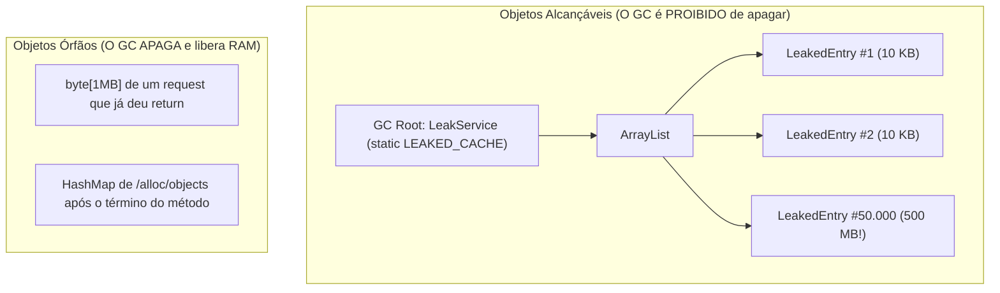
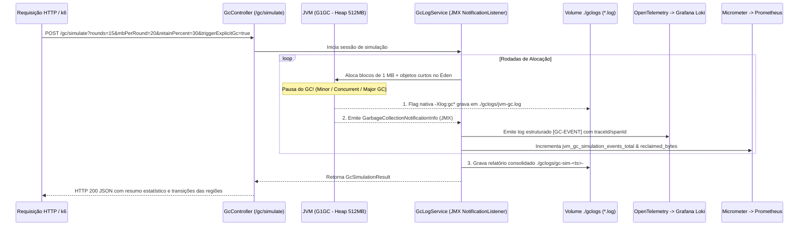

# Estudo de Caso & Guia Técnico: Monitoramento e Simulação de Garbage Collector (GC) no Java 25 com JMX, OpenTelemetry e Grafana Loki

## 1. Visão Geral e a Tríade de Diagnóstico da JVM

No **Observability Hub** (**Spring Boot 4.1.1 + Java 25**), o monitoramento profundo da JVM é dividido em três pilares complementares que cobrem todo o ciclo de vida de um incidente de performance ou estabilidade:

| Pilar de Diagnóstico | Artefato Gerado | Quando Atua? | O que Responde? |
| :--- | :--- | :--- | :--- |
| **1. Thread Dump** ([`ThreadDumpService`](../src/main/java/com/example/observability/service/ThreadDumpService.java)) | `./threaddumps/*.tdump` | CPU >= 90% ou sob demanda | *"Qual linha de código ou lock está queimando CPU ou travando as threads agora?"* |
| **2. Garbage Collector Logs** ([`GcLogService`](../src/main/java/com/example/observability/service/GcLogService.java)) | `./gclogs/*.log` + **Loki** | Em cada coleta de lixo (Minor / Major GC) | *"A memória está sendo reciclada de forma saudável ou o Old Gen está enchendo rumo ao colapso?"* |
| **3. Heap Dump** (`-XX:+HeapDumpOnOutOfMemoryError`) | `./heapdumps/*.hprof` | No instante da morte por `OutOfMemoryError` | *"Qual classe/lista reteve milhões de objetos e matou a JVM?"* |

Enquanto o **Heap Dump** é uma autópsia (gerada quando a JVM já morreu) e consome centenas de megabytes, os **Logs do Garbage Collector** funcionam como um **eletrocardiograma em tempo real**: eles mostram a saúde da memória a cada segundo, permitindo detectar vazamentos (*Memory Leaks*), alocações gigantes (*Humongous Allocations*) e pausas longas (*Stop-The-World*) muito antes da aplicação cair.

---

## 2. Como o Garbage Collector (G1GC) Funciona no Java 25

O coletor padrão do Java 25 é o **G1GC (Garbage-First Garbage Collector)**. Ele divide a memória Heap (configurada em `512 MB` no projeto) em regiões lógicas:



1. **Minor GC (`G1 Young Generation` / `end of minor GC`)**:
   - Ocorre quando o **Eden** enche.
   - É extremamente rápido (geralmente `2 ms` a `15 ms`).
   - Quase todos os objetos criados dentro de uma requisição HTTP já terminaram de ser usados e morrem aqui, fazendo o Eden voltar a `0 MB`.
2. **Concurrent GC / Mixed GC (`G1 Concurrent GC`)**:
   - Marca objetos vivos na região **Old Gen** em paralelo com a aplicação rodando, sem travar as requisições por muito tempo.
3. **Major / Full GC (`G1 Old Generation` / `end of major GC`)**:
   - Ocorre quando o **Old Gen** fica cheio, quando há pressão severa de memória ou quando `System.gc()` é chamado.
   - É uma limpeza pesada e mais lenta, pois varre todo o Heap tentando compactar regiões antigas.

---

## 3. Por que às vezes o GC não consegue limpar e estoura `OutOfMemoryError`?

O Garbage Collector segue uma **regra de ouro inviolável**: ele **só pode apagar um objeto se tiver 100% de certeza de que nenhuma parte do código consegue mais acessá-lo**.

Para descobrir quem está vivo, o GC parte dos chamados **GC Roots** (Raízes do GC):
- Variáveis locais de métodos que estão em execução naquele exato momento (na *stack* das threads ativas).
- Atributos `static` de qualquer classe.
- Beans singletons do Spring (`@Service`, `@Controller`, `@Component`) e seus atributos internos.



### 3.1. Comparando na Prática os Dois Endpoints do Projeto

#### Cenário A: Quando o GC CONSEGUE limpar ([`AllocationController.allocateBytes`](../src/main/java/com/example/observability/controller/AllocationController.java))
```java
@GetMapping("/bytes")
public Map<String, Object> allocateBytes(@RequestParam(defaultValue = "10") int mb) {
    List<byte[]> blocks = new ArrayList<>(mb); // <-- Variável LOCAL (na pilha da Thread)
    for (int i = 0; i < mb; i++) {
        blocks.add(new byte[1024 * 1024]);
    }
    return Map.of("allocatedMb", blocks.size());
} // <-- Ao chegar no return, a variável 'blocks' deixa de existir!
```
- Assim que o método termina e devolve o HTTP 200, os blocos de `byte[]` ficam completamente órfãos. Na próxima passagem do GC, 100% dessa memória é reciclada.

#### Cenário B: Quando o GC NÃO CONSEGUE limpar ([`LeakService.leak`](../src/main/java/com/example/observability/service/LeakService.java))
```java
@Service
public class LeakService {
    // <-- Variável STATIC: vive enquanto a JVM estiver ligada!
    private static final List<LeakedEntry> LEAKED_CACHE = new ArrayList<>();

    public long leak(int entries) {
        for (int i = 0; i < entries; i++) {
            LEAKED_CACHE.add(buildEntry()); // <-- Objeto fica preso na lista estática
        }
        return LEAKED_CACHE.size();
    }
}
```
- Mesmo após o término da requisição HTTP, `LEAKED_CACHE` continua apontando para todos os objetos criados.
- O GC olha para a lista, vê que os objetos ainda são alcançáveis pelo código e os promove do **Eden** → **Survivor** → **Old Gen**.

### 3.2. As 4 Causas Reais de `OutOfMemoryError` em Produção

| Causa | Explicação Prática | Comportamento do GC antes da queda |
| :--- | :--- | :--- |
| **1. Memory Leak (Vazamento)** | Listas, Mapas ou Caches em memória sem política de expiração (TTL) ou tamanho máximo. | O GC roda repetidas vezes (*Major GC*), mas o campo `freedMb` cai para `0 MB` porque tudo está referenciado. |
| **2. Pico de Tráfego Concorrente** | Não há bug de leak, mas o Heap é de `512 MB` e chegam 60 requisições simultâneas alocando `10 MB` cada (`600 MB` ativos ao mesmo tempo). | Como as 60 requisições ainda estão no meio da execução, suas variáveis locais são *GC Roots* ativos e não podem ser limpas. |
| **3. Carga Única Gigante (`findAll`)** | Uma única chamada tenta carregar milhões de linhas do banco ou ler um arquivo de `600 MB` inteiro na RAM com `Files.readAllBytes()`. | O objeto único sendo construído é maior do que todo o espaço livre do Heap. |
| **4. GC Overhead Limit Exceeded (*GC Thrashing*)** | O Heap fica 98% cheio de objetos vivos. A aplicação congela fazendo um Full GC atrás do outro para tentar liberar 1% de espaço. | Quando a JVM gasta **> 98% do tempo** em GC e recupera **< 2% do Heap** por 5 coletas seguidas, ela aborta com `OutOfMemoryError`. |

---

## 4. Arquitetura Híbrida de Monitoramento de GC Implementada

Para unir **didática em tempo real** com **padrão de produção**, implementamos duas camadas simultâneas:



### 4.1. Camada 1: Listener Programático via JMX ([`GcLogService`](../src/main/java/com/example/observability/service/GcLogService.java))
Ao iniciar a aplicação (`@PostConstruct`), o `GcLogService` percorre `ManagementFactory.getGarbageCollectorMXBeans()` e registra um `NotificationListener` em cada coletor da JVM.
Sempre que uma coleta termina, a JVM entrega um objeto `GarbageCollectionNotificationInfo` contendo:
- **`gcName`**: `G1 Young Generation`, `G1 Concurrent GC` ou `G1 Old Generation`.
- **`gcAction`**: `end of minor GC`, `end of concurrent GC pause` ou `end of major GC`.
- **`gcCause`**: `G1 Evacuation Pause`, `G1 Humongous Allocation`, `System.gc()`, etc.
- **`durationMs`**: Tempo exato da pausa em milissegundos.
- **`memoryUsageBeforeGc` e `memoryUsageAfterGc`**: Mapas com os bytes exatos usados antes e depois em cada pool (`G1 Eden Space`, `G1 Survivor Space`, `G1 Old Gen`), permitindo calcular quantos megabytes foram reciclados (`freedMb`).

### 4.2. Camada 2: Log Nativo Unificado da JVM (`-Xlog:gc*`)
No [`docker-compose.yml`](../docker-compose.yml), a variável `JAVA_TOOL_OPTIONS` inclui:
```text
-Xlog:gc*:file=/app/gclogs/jvm-gc.log:time,uptime,level,tags:filecount=5,filesize=20M
```
Isso gera o arquivo `jvm-gc.log` com rotação automática (5 arquivos de até 20 MB), compatível com analisadores visuais de mercado como **GCViewer** e **GCEasy**.

### 4.3. Como os Logs Chegam ao Grafana Loki?
Cada evento capturado pelo `GcLogService` é registrado via SLF4J/Logback (`log.info("[GC-EVENT] ...")`) e segue a esteira OTLP:
1. **No Docker**: O `-javaagent:/app/opentelemetry-javaagent.jar` intercepta o Logback e envia via gRPC (`http://otel-collector:4317`).
2. **Na IDE (sem Java Agent)**: A classe [`OpenTelemetryLogbackConfig`](../src/main/java/com/example/observability/config/OpenTelemetryLogbackConfig.java) anexa o appender `OTEL_SPRING_BRIDGE` no Logback e envia via HTTP (`http://localhost:4318/v1/logs`).
3. **No OpenTelemetry Collector** ([`otel-collector-config.yaml`](../otel-collector-config.yaml)): O pipeline `logs` agrupa em lotes (`batch`) e exporta para o endpoint nativo OTLP do Loki (`http://loki:3100/otlp`).

---

## 5. Anatomia do Relatório de Simulação Gerado em `./gclogs`

Cada chamada a `/gc/simulate` gera um arquivo único e imutável (`StandardOpenOption.CREATE_NEW`) em `./gclogs/gc-sim-<timestamp>-#<seq>.log`:

```text
================================================================================
OBSERVABILITY HUB - RELATORIO DE SIMULACAO DO GARBAGE COLLECTOR (JVM)
================================================================================
Simulacao #          : 1
Timestamp Inicio     : 2026-11-10T00:06:34.210Z
Duracao Total        : 1580 ms
Parametros           : rounds=15, mbPerRound=20 MB, retainPercent=30%, explicitGc=true
Total Alocado        : 300 MB (Retido durante a simulacao: 90 MB)
Heap Antes -> Depois : 42 MB -> 48 MB (Max Heap: 512 MB)
================================================================================

--------------------------------------------------------------------------------
1. LINHA DO TEMPO DE EVENTOS DO GARBAGE COLLECTOR CAPTURADOS
--------------------------------------------------------------------------------
[21:06:34.512] GC #14 | G1 Young Generation  | end of minor GC  | cause=G1 Evacuation Pause    | pause=  6 ms | Heap: 245 MB ->  92 MB (-153 MB) | Eden: 168->0MB | Survivor: 12->14MB | Old Gen: 65->78MB
[21:06:35.791] GC #1  | G1 Old Generation    | end of major GC  | cause=System.gc()            | pause= 94 ms | Heap:  99 MB ->  48 MB ( -51 MB) | Old Gen: 86->48MB | Survivor: 7->0MB | Eden: 1->0MB

--------------------------------------------------------------------------------
2. RESUMO ESTATISTICO E DIAGNOSTICO DE COMPORTAMENTO DO GC
--------------------------------------------------------------------------------
Total de Eventos GC  : 2 (1 Minor GC / 1 Major GC)
Tempo Total em Pausa : 100 ms (Maior pausa individual: 94 ms)
Overhead de GC       : 6.33% do tempo total da simulacao
Total Memoria Limpa  : 204 MB reciclados pelo GC

[ANALISE]: Com retainPercent > 0%, parte dos objetos sobreviveu ao Minor GC no Eden
e foi promovida para Survivor / Old Gen, reduzindo a taxa de limpeza imediata.
================================================================================
```

---

## 6. Guia Prático de Testes e Consultas no Grafana Loki

### 6.1. Executando as Simulações via HTTP ([`requests.http`](../requests.http))

```powershell
# 1. Consultar status do monitor de GC, coletores da JVM e arquivos salvos em ./gclogs
Invoke-RestMethod "http://localhost:8080/gc/status" | ConvertTo-Json -Depth 5

# 2. Cenário Saudável (0% retenção): objetos morrem no Eden e são 100% limpos no Minor GC
Invoke-RestMethod -Method Post "http://localhost:8080/gc/simulate?rounds=15&mbPerRound=20&retainPercent=0&triggerExplicitGc=false"

# 3. Cenário com Retenção (30% retido + Full GC ao final): promove objetos para Old Gen
Invoke-RestMethod -Method Post "http://localhost:8080/gc/simulate?rounds=15&mbPerRound=20&retainPercent=30&triggerExplicitGc=true"
```

### 6.2. Consultas LogQL para o Grafana Loki (`http://localhost:3000/explore`)

Selecione o datasource **Loki** no menu **Explore** do Grafana e utilize as queries abaixo:

| Objetivo da Consulta | Query LogQL |
| :--- | :--- |
| **Listar todos os eventos de GC em tempo real** | `{service_name="observability-hub"} |= "[GC-EVENT]"` |
| **Ver início, eventos de GC e conclusão da simulação** | `{service_name="observability-hub"} \|~ "GC-EVENT\|simulacao de GC\|Simulacao de GC"` |
| **Filtrar apenas coletas pesadas (Major / Full GC)** | `{service_name="observability-hub"} |= "[GC-EVENT]" |= "end of major GC"` |
| **Filtrar pausas de GC acima de 10 ms (via parser `logfmt`)** | `{service_name="observability-hub"} |= "[GC-EVENT]" \| logfmt \| durationMs > 10` |
| **Gráfico de total de MB reciclados por coletor a cada minuto** | `sum by (collector) (sum_over_time({service_name="observability-hub"} |= "[GC-EVENT]" \| logfmt \| unwrap freedMb [1m]))` |

### 6.3. Métricas Expostas no Prometheus (`http://localhost:9090`)

- `jvm_gc_simulation_events_total{application="observability-hub", collector="...", action="...", cause="..."}`: Contador total de coletas capturadas pelo listener JMX.
- `jvm_gc_simulation_reclaimed_bytes_total{application="observability-hub", collector="..."}`: Total acumulado de bytes reciclados no Heap pelas coletas de GC.
