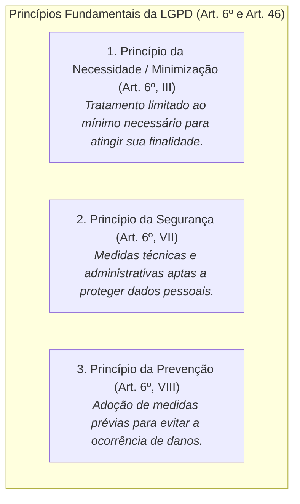
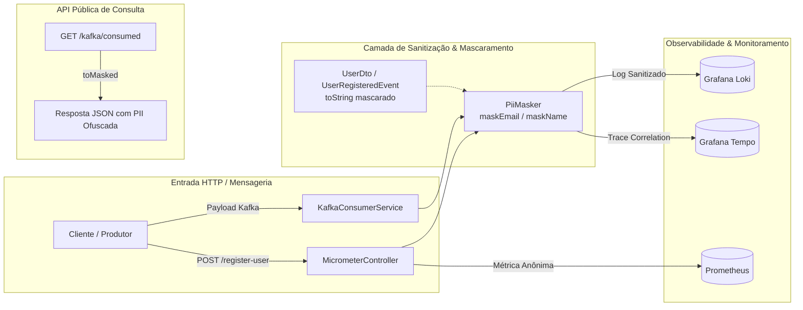
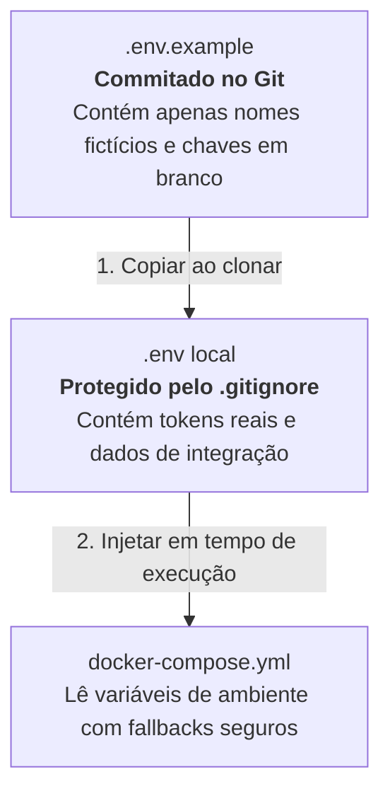

# Estudo de Caso & Guia Prático: Gestão de Segredos, Privacy by Design e Conformidade LGPD em Plataformas de Observabilidade

## 1. Visão Geral e Contexto

Em sistemas modernos distribuídos e microsserviços, a **Observabilidade** (composta por Logs centralizados, Tracing distribuído, Métricas e Profiling contínuo) é indispensável para garantir confiabilidade e alta performance.

No entanto, arquiteturas de observabilidade introduzem um vetor crítico de risco: **o vazamento passivo de dados sensíveis e credenciais**.
Quando aplicações gravam payloads de requisições ou eventos de mensageria diretamente em logs (como Grafana Loki) e spans de trace (como Grafana Tempo), qualquer desenvolvedor, analista ou operador com acesso aos painéis de monitoramento tem visibilidade sobre esses dados.

Este estudo detalha os princípios teóricos, os riscos de conformidade com a **LGPD (Lei Geral de Proteção de Dados - Lei nº 13.709/2018)**, os padrões de **Privacy by Design** e as soluções arquiteturais implementadas no **Observability Hub**.

---

## 2. Fundamentação Legal: LGPD e Engenharia de Software

A LGPD estabelece direitos para os titulares de dados e obrigações para os agentes de tratamento. No ciclo de vida do desenvolvimento de software, destacam-se três princípios fundamentais:



### O Risco de Dados Pessoais (PII) em Logs e Traces
- **Identificação Direta**: E-mails, nomes completos, CPFs e endereços trafegando em texto aberto.
- **Armazenamento Descontrolado**: Logs centralizados no Loki ou Elasticsearch possuem retenção configurada para fins de debug e auditoria. Se armazenarem dados pessoais em texto claro, tornam-se bases de dados sujeitas a pedidos de exclusão (direito do titular) e incidentes de segurança.
- **Violação do Princípio da Minimização**: O time de infraestrutura/SRE precisa saber *que um usuário se registrou com sucesso*, mas **não** precisa saber o nome ou o e-mail exato do usuário para diagnosticar latência ou erros 5xx.

---

## 3. Arquitetura da Solução Implementada

Para mitigar esses riscos sem comprometer a capacidade de diagnóstico e correlação do sistema, foi adotada a abordagem **Privacy by Design / Privacy by Default**:



### 3.1. Utilitário Determinístico de Mascaramento (`PiiMasker`)
Criada uma classe utilitária de alto desempenho para ofuscar dados pessoais preservando apenas informações essenciais para diagnóstico de domínio:

- **E-mails**: `usuario@example.com` $\rightarrow$ `u***o@example.com`
  - Mantém o caractere inicial e final do identificador para conferência visual.
  - Preserva o domínio do provedor `@example.com`, permitindo investigar problemas com provedores específicos sem expor a pessoa física.
- **Nomes**: `Marcos Daniel Lacroix` $\rightarrow$ `M*** D*** L***`
  - Preserva as iniciais de cada termo, impedindo a identificação do titular por terceiros.

### 3.2. Segurança Defensiva nos Records do Java 25 (`toString()`)
Em vez de depender exclusivamente da disciplina do desenvolvedor para chamar funções de mascaramento, os records de transferência de dados (`UserDto` e `UserRegisteredEvent`) tiveram seus métodos `toString()` customizados:

```java
public record UserDto(String name, String email) {
    @Override
    public String toString() {
        return "UserDto[name=" + PiiMasker.maskName(name) + ", email=" + PiiMasker.maskEmail(email) + "]";
    }
}
```

**Benefício**: Qualquer chamada inadvertida como `log.info("Recebido: {}", dto)` ou `System.out.println(dto)` passa a emitir automaticamente dados protegidos, enquanto a serialização JSON da API REST e do Kafka permanece intacta.

### 3.3. Endpoint Seguro de Inspeção (`GET /kafka/consumed`)
No modelo anterior, os eventos consumidos do Kafka ficavam disponíveis em memória e eram expostos publicamente na rota de consulta. A solução implementou a conversão automática para eventos mascarados via `UserRegisteredEvent.toMasked()`:

```json
{
  "userRegistrationEvents": [
    {
      "eventId": "3c7b39b0-9a25-42d8-9dc9-1d418bc250e3",
      "name": "M*** L***",
      "email": "m***x@example.com",
      "registeredAt": "2026-10-26T22:30:00Z"
    }
  ]
}
```

---

## 4. Gestão de Segredos e Credenciais

Além da proteção aos dados pessoais de usuários, foi estruturada a proteção contra o vazamento de **credenciais corporativas**.

### 4.1. Ciclo de Vida do `.env.example` vs. `.env`



### 4.2. Boas Práticas Adotadas
1. **Regras Estritas no `.gitignore`**:
   Configurado para ignorar `.env`, `.env.*` e `.env.local`, abrindo exceção explícita apenas para o arquivo de exemplo `!.env.example`.
2. **Parametrização do Grafana no Docker Compose**:
   As credenciais de administração do Grafana foram parametrizadas para ler `${GRAFANA_ADMIN_USER:-admin}` e `${GRAFANA_ADMIN_PASSWORD:-admin}`, viabilizando o uso de senhas fortes em ambientes que não sejam de desenvolvimento local.
3. **Auditoria de Histórico do Git**:
   Verificação de commits antigos para confirmar que tokens de API (como Atlassian Jira Cloud `ATATT...`) nunca foram persistidos no histórico permanente da árvore Git.

---

## 5. Matriz Comparativa: Antes vs. Depois

| Aspecto | Estado Anterior | Estado Atual (Corrigido) | Conformidade |
| :--- | :--- | :--- | :--- |
| **Logs de Registro de Usuários** | `log.info("... {}", dto)` e `dto.email()` com dados brutos | Dados mascarados via `PiiMasker` e `dto.toString()` | ✅ LGPD Art. 6º, III e Art. 46 |
| **Logs de Publicação no Kafka** | Gravava o payload JSON bruto com dados pessoais | Grava apenas o `eventId` opaco e a chave mascarada | ✅ Privacy by Design |
| **Endpoint de Consulta `/kafka/consumed`** | Retornava nomes e e-mails de todos os usuários em texto puro | Retorna eventos com nomes e e-mails ofuscados (`toMasked()`) | ✅ Segurança e Minimização |
| **Modelo de Configuração de Segredos** | Sem arquivo de exemplo; risco de compartilhamento do `.env` real | `.env.example` sanitizado e documentado | ✅ Gestão de Segredos |
| **Credenciais Grafana Admin** | Fixas em texto claro (`admin`/`admin`) | Parametrizadas via variáveis de ambiente com fallback | ✅ Hardening de Infraestrutura |

---

## 6. Checklist Contínuo para o Time de Engenharia

Ao desenvolver novos recursos na plataforma, siga estas diretrizes:

- [ ] **Não logar entidades completas**: Prefira registrar identificadores técnicos (ex: `UUID`, `orderId`, `traceId`) em vez de dados pessoais do cliente.
- [ ] **Utilizar o `PiiMasker` para campos sensíveis**: Sempre que for necessário registrar um e-mail ou nome para fins de troubleshooting, aplique o método correspondente.
- [ ] **Nunca comitar segredos**: Nunca incluir tokens, senhas ou URLs internas da empresa em branches do Git; use variáveis de ambiente.
- [ ] **Validar endpoints de teste/debug**: Garantir que endpoints criados para suporte a testes não exponham dados sensíveis quando chamados em rede.
