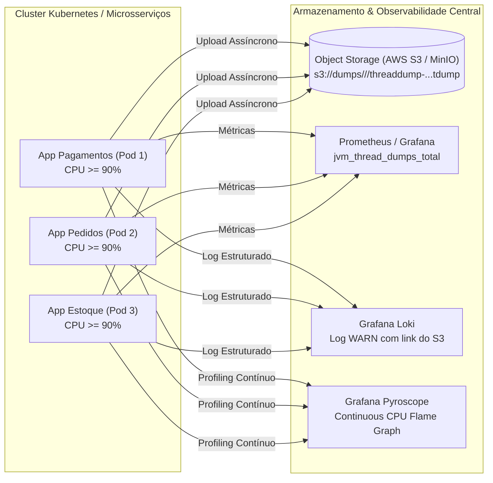

# Estudo de Caso & Guia Técnico: Captura Automática de Thread Dump por Uso Elevado de CPU (>= 90%) no Java 25 e Estratégias de Escala

## 1. Visão Geral e Motivação

Em ambientes de produção Java, incidentes críticos geralmente se dividem em duas categorias principais de esgotamento de recursos: **Memória (Heap)** e **Processamento (CPU / Threads)**.

Para problemas de memória, a JVM oferece nativamente a flag `-XX:+HeapDumpOnOutOfMemoryError`, que grava automaticamente um arquivo `.hprof` quando o Heap se esgota. No entanto, **a JVM não possui uma flag nativa equivalente para CPU alta** (como um hipotético `-XX:+ThreadDumpOnHighCpu`).

Quando uma aplicação atinge **90% a 100% de uso de CPU** devido a loops infinitos, expressões regulares catastróficas (*ReDoS*), contenção severa de threads ou serializações pesadas, o pico muitas vezes dura poucos segundos ou derruba o container antes que um engenheiro consiga acessar o pod e executar `jstack` ou `jcmd` manualmente.

Este estudo documenta a implementação de um **Watchdog Interno de CPU e Gerador Automático de Thread Dump** no **Observability Hub** (**Spring Boot 4.1.1 + Java 25**), bem como os padrões arquiteturais para escalar essa solução para dezenas de microsserviços.

---

## 2. Diferença Fundamental: Heap Dump vs. Thread Dump

| Característica | Heap Dump (`.hprof`) | Thread Dump (`.tdump`) |
| :--- | :--- | :--- |
| **O que registra?** | Fotografia da **memória** (objetos alocados, referências e tamanho retido no Heap). | Fotografia da **execução** (pilha de chamadas / *stack trace*, estado e locks de cada thread). |
| **Quando usar?** | `OutOfMemoryError`, vazamento de memória (*Memory Leak*), pressão excessiva no GC. | **Pico de CPU (>= 90%)**, *Deadlocks*, lentidão extrema com recursos livres, *Thread Starvation*. |
| **Gatilho na JVM** | Flag nativa `-XX:+HeapDumpOnOutOfMemoryError` | Monitoramento programático via **JMX (`OperatingSystemMXBean` + `ThreadMXBean`)** |
| **Tamanho típico** | Centenas de MB a vários GB (proporcional ao `-Xmx`). | Leve: poucos KB a alguns MB (texto puro estruturado). |
| **Impacto (Pause)** | Alto (*Stop-The-World* prolongado). | Muito baixo (milissegundos). |

---

## 3. Arquitetura da Solução Implementada

O componente [`ThreadDumpService`](../src/main/java/com/example/observability/service/ThreadDumpService.java) opera dentro da própria JVM como um monitor assíncrono leve:

```mermaid
flowchart TD
    SCHED["@Scheduled (a cada 5s)<br/>monitorCpuAndDumpIfNeeded()"] --> OS_BEAN["OperatingSystemMXBean<br/>getProcessCpuLoad()"]
    OS_BEAN --> CHECK_CPU{"CPU do Processo<br/>>= 90% (0.90)?"}

    CHECK_CPU -->|Não (< 90%)| METRIC_GAUGE["Atualiza Gauge Micrometer<br/>jvm_threaddump_last_cpu_ratio"]
    CHECK_CPU -->|Sim (>= 90%)| CHECK_COOLDOWN{"Cooldown de 60s<br/>expirou?"}

    CHECK_COOLDOWN -->|Em Cooldown| SKIP["Ignora disparo (evita flood em disco)"]
    CHECK_COOLDOWN -->|Liberado| COLLECT["Coleta Diagnóstico Completo da JVM"]

    subgraph "Coleta Forense JMX (Java 25)"
        COLLECT --> TOP_CPU["1. Ranking Top 10 Threads por Tempo de CPU<br/>(ThreadMXBean.getThreadCpuTime)"]
        COLLECT --> DEADLOCK["2. Detecção Automática de Deadlocks<br/>(ThreadMXBean.findDeadlockedThreads)"]
        COLLECT --> PLATFORM["3. Stack Traces + Monitors + Synchronizers<br/>(ThreadMXBean.dumpAllThreads)"]
        COLLECT --> LOOM["4. Virtual Threads & Carrier Threads<br/>(HotSpotDiagnosticMXBean.dumpThreads)"]
    end

    TOP_CPU & DEADLOCK & PLATFORM & LOOM --> WRITE_NEW["Gravação Imutável (CREATE_NEW)<br/>threaddump-yyyyMMdd-HHmmss-SSS-seq-cpuXXpct.tdump"]
    WRITE_NEW --> COUNTER["Incrementa Counter Prometheus<br/>jvm_thread_dumps_total{trigger='cpu_threshold'}"]
```

---

## 4. Anatomia Técnica: APIs Nativas da JVM Utilizadas

### 4.1. Medição Precisa da CPU do Processo (`OperatingSystemMXBean`)
Para distinguir se o consumo de CPU vem da própria aplicação Java ou de outro processo vizinho na máquina/node, utilizamos a extensão da plataforma HotSpot `com.sun.management.OperatingSystemMXBean`:

- **`osMXBean.getProcessCpuLoad()`**: Retorna um `double` entre `0.0` e `1.0` representando exclusivamente a fatia de CPU consumida pelo processo da JVM no último intervalo (ex.: `0.92` = `92.00%`).
- **`osMXBean.getCpuLoad()`**: Retorna o uso global de CPU do Sistema Operacional/Container (registrado no cabeçalho do dump para contexto).

### 4.2. Ranking das Threads Vilãs de CPU (`ThreadMXBean.getThreadCpuTime`)
Um Thread Dump tradicional mostra o que todas as threads estão fazendo no instante da coleta, mas em uma JVM com 200 threads pode ser difícil identificar qual delas queimou CPU nos últimos segundos.
Por isso, o `ThreadDumpService` habilita `threadMXBean.setThreadCpuTimeEnabled(true)` e calcula o tempo acumulado de CPU em milissegundos de cada thread (`getThreadCpuTime(id) / 1_000_000`), gerando no topo do arquivo a seção **TOP THREADS POR TEMPO ACUMULADO DE CPU**:

```text
--------------------------------------------------------------------------------
2. TOP THREADS POR TEMPO ACUMULADO DE CPU
--------------------------------------------------------------------------------
  - [id=48  ] cpu-stress-worker-1                           | Estado: RUNNABLE      | CPU Total: 14230 ms
  - [id=49  ] cpu-stress-worker-2                           | Estado: RUNNABLE      | CPU Total: 14195 ms
  - [id=1   ] main                                          | Estado: WAITING       | CPU Total: 1850 ms
```

### 4.3. Detecção Automática de Deadlocks e Locks
- **`threadMXBean.findDeadlockedThreads()`**: Detecta ciclos de travamento tanto em monitores tradicionais (`synchronized`) quanto em sincronizadores `java.util.concurrent` (`ReentrantLock`, `ReadWriteLock`).
- **`threadMXBean.dumpAllThreads(true, true)`**: Os dois parâmetros booleanos (`lockedMonitors = true`, `lockedSynchronizers = true`) instruem a JVM a incluir exatamente qual objeto cada thread bloqueou (`- locked <0x...>`) e qual objeto ela está aguardando (`- waiting on <0x...>`).

### 4.4. Suporte a Virtual Threads no Java 25 (`HotSpotDiagnosticMXBean`)
Como o `ThreadMXBean.dumpAllThreads()` clássico lista apenas *Platform Threads*, aplicações modernas que utilizam **Virtual Threads (Projeto Loom no Java 21/25)** precisam de uma visão complementar. O serviço invoca:

```java
hotSpotDiagnosticMXBean.dumpThreads(
    tempHotSpotDump.toAbsolutePath().toString(),
    HotSpotDiagnosticMXBean.ThreadDumpFormat.TEXT_PLAIN
);
```
Isso anexa ao final do arquivo `.tdump` todas as Virtual Threads ativas e seus respectivos *Carrier Threads* do `ForkJoinPool`.

---

## 5. Imutabilidade Forense: Garantia de Nunca Sobrescrever Arquivos

Em uma investigação de incidente (*Post-Mortem*), o primeiro Thread Dump gerado no início da anomalia é frequentemente o mais valioso, pois mostra a causa raiz antes do efeito cascata. Se um arquivo posterior sobrescrever o anterior, a evidência primária é perdida.

Para garantir que **cada captura sempre gere um arquivo novo e exclusivo**, aplicamos três camadas de proteção no método `resolveUniqueDumpFile`:

1. **Nomenclatura com Alta Resolução + Sequencial Atômico**:
   Combina data/hora com milissegundos (`yyyyMMdd-HHmmss-SSS`), um contador atômico crescente (`AtomicLong dumpSequence`) e o percentual de CPU observado:
   ```text
   threaddump-20261105-214645-620-1-cpu91pct.tdump
   threaddump-20261105-214645-652-2-cpu91pct.tdump
   ```
2. **Verificação de Colisão em Disco (`while (Files.exists(candidate))`)**:
   Caso a aplicação seja reiniciada no mesmo milissegundo e já exista um arquivo no volume persistente, um sufixo incremental adicional é anexado.
3. **Trava no Sistema de Arquivos (`StandardOpenOption.CREATE_NEW`)**:
   Em vez de usar `TRUNCATE_EXISTING`, o arquivo é aberto com `CREATE_NEW`, que instrui o próprio Sistema Operacional a falhar com `FileAlreadyExistsException` caso o caminho já exista, tornando impossível sobrescrever qualquer dump anterior.

---

## 6. Como Escalar essa Solução para Várias Aplicações (Produção / Kubernetes)

Quando saímos de uma única aplicação para dezenas de microsserviços rodando em múltiplos pods no Kubernetes, devemos evoluir dois eixos: **onde os arquivos são salvos** e **como o código do monitor é distribuído**.



### 6.1. Armazenamento Centralizado (Evitando Perda em Containers Efêmeros)
Em Kubernetes, se um pod em 100% de CPU falhar no *Liveness Probe* e for reiniciado, qualquer arquivo salvo apenas no disco local do container é perdido.
- **Particionamento por Aplicação e Instância**:
  O caminho de saída deve incluir o nome da aplicação (`spring.application.name`) e o `HOSTNAME` (nome do pod):
  ```text
  <application-name>/<pod-hostname>/threaddump-yyyyMMdd-HHmmss-SSS-seq-cpuXXpct.tdump
  ```
- **Envio para Object Storage (AWS S3 / Google Cloud Storage / Azure Blob / MinIO)**:
  Logo após gravar o arquivo localmente em `/tmp`, a aplicação faz o upload assíncrono para um bucket S3 corporativo e emite um log `WARN` no **Loki** contendo a URI do objeto no S3. No bucket S3, configura-se uma *Lifecycle Rule* (ex.: mover para Glacier ou expirar após 30 dias).

### 6.2. Comparativo das 4 Estratégias de Distribuição em Escala

| Estratégia | Como Funciona | Vantagens | Desvantagens / Quando Evitar |
| :--- | :--- | :--- | :--- |
| **1. Spring Boot Custom Starter** (`company-threaddump-starter`) | Extrai o `ThreadDumpService` para uma lib Maven com `@AutoConfiguration`. Basta adicionar no `pom.xml`. | Padronizado, configurável via `application.yaml`, integra nativamente com Micrometer e S3. | Funciona apenas para aplicações Spring Boot; requer atualização de dependência nos projetos. |
| **2. Java Agent (`-javaagent`) na Imagem Base** | Empacota o monitor como um agente JVM (`premain`) e injeta via `JAVA_TOOL_OPTIONS` no `Dockerfile` base da empresa. | **Zero alteração de código** ou `pom.xml`; funciona em Spring Boot, Quarkus, Jakarta EE e sistemas legados. | Não tem acesso direto aos beans do Spring (precisa exportar métricas via JMX/OTel diretamente). |
| **3. Gatilho Externo (Prometheus Alert + Webhook `/actuator/threaddump`)** | O alerta de CPU > 90% no Prometheus/Grafana chama um webhook que faz `GET /actuator/threaddump` no pod afetado. | Nenhuma thread agendada dentro das aplicações. | **Risco crítico**: quando a JVM está em 95%-100% de CPU, o pool HTTP do Tomcat pode estar saturado e dar *timeout* na requisição externa, falhando em capturar o dump. |
| **4. Continuous Profiling (Grafana Pyroscope)** | Agente `-javaagent:/app/pyroscope.jar` envia amostras contínuas de CPU e Locks para o servidor Pyroscope. | Visão histórica contínua em Flame Graph no Grafana para todas as apps sem gerenciar arquivos `.tdump`. | Não substitui 100% o `.tdump` quando é necessário inspecionar IDs exatos de monitores em *deadlock* ou o estado individual de cada thread parada. |

> [!TIP]
> **Recomendação de Arquitetura para Produção**: Combine o **Continuous Profiling (Pyroscope)** (para enxergar continuamente o Flame Graph de CPU no Grafana) com o **Watchdog Interno (via Starter ou Java Agent)** salvando em **S3/Volume Persistente**, pois o watchdog interno roda em uma thread já alocada dentro da JVM e consegue capturar o Thread Dump mesmo quando a porta HTTP `8080` da aplicação já parou de responder sob saturação extrema de CPU.

---

## 7. Guia Rápido de Configuração e Testes no Projeto

### 7.1. Propriedades no `application.yaml`
```yaml
app:
  threaddump:
    enabled: ${THREAD_DUMP_ENABLED:true}
    cpu-threshold: ${THREAD_DUMP_CPU_THRESHOLD:0.90}        # Limiar de 90% de uso de CPU
    check-interval-ms: ${THREAD_DUMP_CHECK_INTERVAL_MS:5000} # Verificação a cada 5 segundos
    cooldown-ms: ${THREAD_DUMP_COOLDOWN_MS:60000}           # Cooldown de 60s entre disparos automáticos
    output-dir: ${THREAD_DUMP_PATH:./threaddumps}           # Diretório de saída (nunca sobrescreve)
```

### 7.2. Comandos para Testar Localmente
```powershell
# 1. Consultar status do monitor e arquivos .tdump existentes
Invoke-RestMethod "http://localhost:8080/threaddump/status" | ConvertTo-Json -Depth 5

# 2. Simular pico real de CPU (> 90%) em todos os núcleos por 15 segundos
Invoke-RestMethod "http://localhost:8080/threaddump/stress-cpu?seconds=15"

# 3. Forçar captura manual sob demanda (sempre cria um novo arquivo .tdump)
Invoke-RestMethod -Method Post "http://localhost:8080/threaddump/capture"

# 4. Listar os arquivos gerados em disco
Get-ChildItem .\threaddumps\
```
