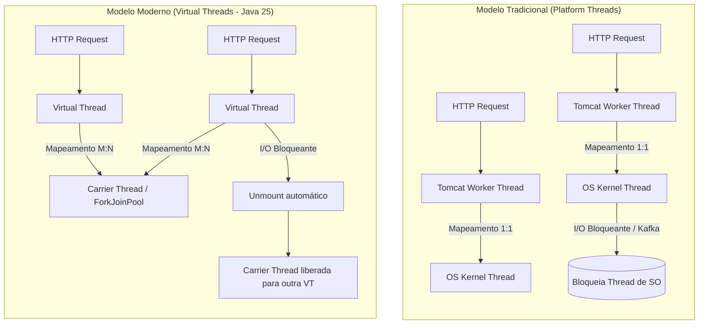

# Estudo de Caso: Platform Threads vs. Virtual Threads no Java 25 com Spring Boot e Kafka

## 1. Visão Geral do Experimento

Este documento registra a análise comparativa de desempenho realizada no projeto **Observability Hub**, avaliando o comportamento da aplicação sob teste de estresse com o modelo tradicional de threads de plataforma (*Platform Threads*) versus o modelo moderno de threads virtuais (*Virtual Threads* / Projeto Loom), executando em **Java 25**.

- **Stack Tecnológica**:
  - Runtime: **Java 25 LTS** (HotSpot 64-bit Server VM)
  - Framework: **Spring Boot 4.1.1**
  - Servidor Web: **Apache Tomcat Embutido**
  - Mensageria: **Apache Kafka 3.x (KRaft)**
  - Observabilidade: Micrometer, OpenTelemetry Java Agent, Pyroscope Profiler
  - Ferramenta de Teste de Carga: **Grafana k6** (`kafka-stress-test.js`)

---

## 2. Fundamentos Teóricos: Platform Threads vs. Virtual Threads



### Principais Diferenças Arquiteturais

| Característica | Platform Threads (Convencional) | Virtual Threads (Java 25) |
| :--- | :--- | :--- |
| **Mapeamento** | 1:1 com threads do Sistema Operacional | M:N gerenciadas no espaço do usuário pela JVM |
| **Custo de Memória** | ~1 MB por thread (stack pré-alocado) | Poucos KB (alocados dinamicamente na Heap) |
| **Troca de Contexto** | Cara (envolve interrupções de hardware e chamadas de sistema) | Muito leve (gerenciada pelo scheduler da JVM) |
| **Comportamento em Bloqueio** | Bloqueia a thread do SO subjacente | Faz *unmount* da thread portadora (*carrier*), liberando CPU |
| **No Java 25** | Mantém as limitações físicas de SO | Beneficia-se da remoção definitiva de *thread pinning* em blocos sincronizados |

---

## 3. Metodologia do Teste de Carga

O teste executou três cenários concorrentes de estresse durante ~57 segundos via k6:

1. **`stress_kafka_publish`** (`POST /kafka/publish`):
   - Publicação direta com taxa crescente até 80 req/s.
2. **`stress_user_registration_kafka`** (`POST /micrometer/register-user`):
   - Execução de validação de negócio, registro de métricas e envio de evento Kafka (até 40 req/s).
3. **`poll_kafka_consumed`** (`GET /kafka/consumed`):
   - Polling concorrente de leitura dos eventos processados em memória.

### Habilitação no Spring Boot

```yaml
spring:
  threads:
    virtual:
      enabled: true
```

Ao ativar esta flag, o Spring Boot instrui o Tomcat a despachar cada conexão HTTP para uma **Virtual Thread** individual, em vez de depender de um pool finito de threads (`server.tomcat.threads.max`).

---

## 4. Tabela Comparativa de Resultados

Resultados extraídos diretamente dos relatórios finais do k6 executados sob as mesmas condições e taxas de injeção:

| Métrica k6 | Platform Threads | Virtual Threads (Java 25) | Variação / Ganho |
| :--- | :---: | :---: | :---: |
| **Total de Requisições Atendidas** | 3.973 | 3.974 | — |
| **Taxa de Erro HTTP / Checks** | 0,00% (100% OK) | 0,00% (100% OK) | Estabilidade mantida |
| **Throughput Médio** | 69,5 req/s | 68,9 req/s | Idêntico (~70 req/s) |
| **Latência Média (`http_req_duration.avg`)** | `7,45 ms` | `5,38 ms` | **-27,8%** 🟢 |
| **Mediana (`http_req_duration.med`)** | `4,09 ms` | `4,15 ms` | Estável |
| **Percentil 90 (`p90`)** | `9,29 ms` | `8,01 ms` | **-13,8%** 🟢 |
| **Percentil 95 (`p95`)** | `14,67 ms` | `10,48 ms` | **-28,6%** 🟢 |
| **Latência Máxima de Pico (`max`)** | `869,75 ms` | `534,86 ms` | **-38,5%** 🟢 |
| **`poll_kafka_consumed` (p95)** | `57,77 ms` | `16,60 ms` | **-71,3%** 🚀 |
| **`stress_kafka_publish` (p95)** | `13,32 ms` | `9,74 ms` | **-26,9%** 🟢 |
| **`stress_user_registration` (p95)** | `13,45 ms` | `10,31 ms` | **-23,3%** 🟢 |
| **Pico de Concorrência de VUs Ativas** | **12 VUs** | **4 VUs** | **-66,7%** 🟢 |

---

## 5. Análise Técnica e Conclusões para Engenharia

### 1. Eliminação de Contenção em Endpoints de Leitura (`poll_kafka_consumed`)
O endpoint de polling concorrente obteve a maior redução de latência: de **`57,77 ms` para `16,60 ms` no p95 (-71,3%)**. No modelo de threads de plataforma, requisições que realizam cópia defensiva de coleções concorrentes (`List.copyOf`) e serialização JSON sofrem fila quando o pool do Tomcat está sob pressão simultânea dos POSTs do Kafka. Com Virtual Threads, cada requisição é atendida imediatamente sem espera por uma thread livre do pool.

### 2. Achatamento da Latência de Cauda (Tail Latency) e Jitter
O tempo máximo caiu de **`869 ms` para `534 ms`** e o pico da operação do Kafka Producer caiu de **`869 ms` para `324 ms`**. No modelo clássico, pausas curtas de Garbage Collection ou contenção de I/O em threads de plataforma bloqueiam a fila inteira. Com threads virtuais, o escalonador desacopla a thread de execução do núcleo de CPU enquanto o I/O da rede/Kafka aguarda confirmação (*ack*).

### 3. Maior Eficiência de Vazão com Menos VUs Retidas
Mesmo atendendo exatamente ao mesmo volume de requisições (~3.974 requisições em 57s), a versão com Virtual Threads exigiu no pico apenas **4 VUs simultâneas** do k6, em comparação com **12 VUs** na versão tradicional. Isso demonstra matematicamente (via *Lei de Little*: $L = \lambda W$) que, como o tempo de residência da requisição no servidor ($W$) diminuiu, a quantidade de requisições em trânsito ($L$) caiu substancialmente.

> [!TIP]
> **Quando usar em Produção**: Virtual Threads são ideais para aplicações padrão Web / REST com I/O bloqueante (chamadas a bancos relacionais JDBC, APIs REST externas, brokers como Kafka/RabbitMQ). Aplicações puramente CPU-bound não obtêm os mesmos ganhos, pois não há tempo ocioso de I/O para desmontagem da thread portadora.
